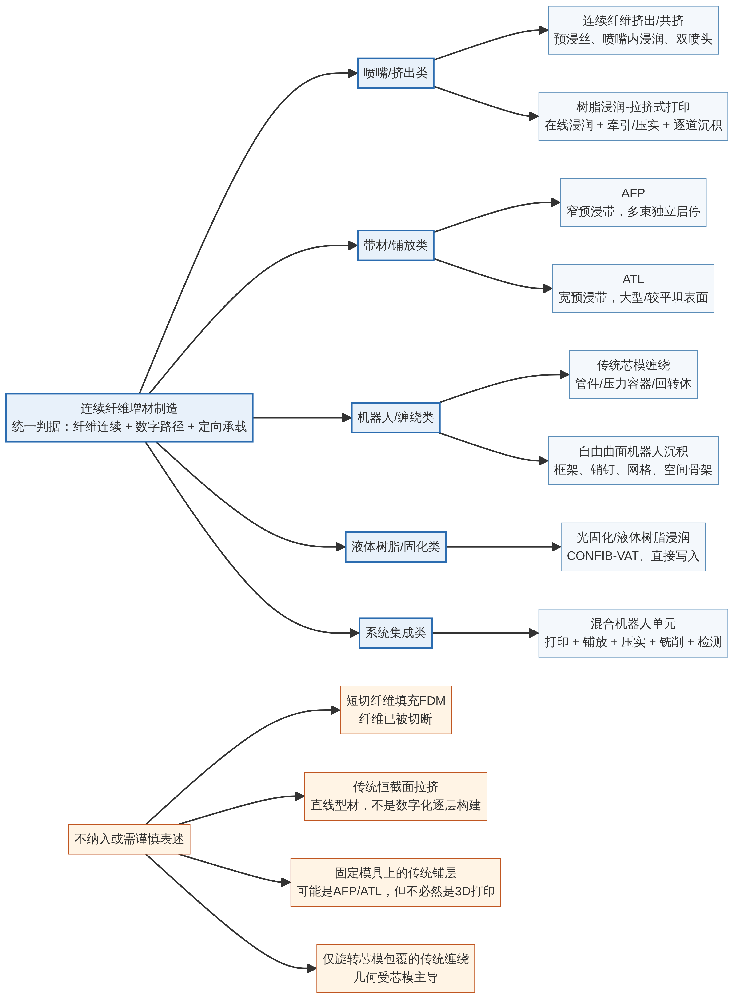
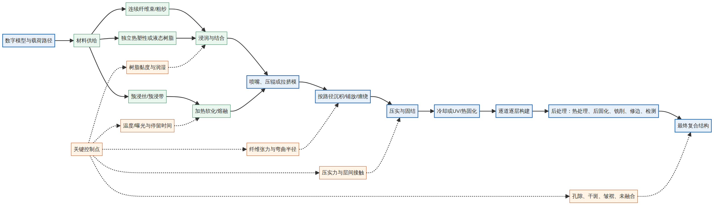

# 什么是连续纤维打印

连续纤维增材制造（Continuous Fiber Additive Manufacturing, CFAM）是指将连续不断的纤维束、纤维丝或连续纤维预浸带，沿数字化路径进行**挤出、铺放、缠绕、浸润或光固化**，使纤维在构件中保持较长的连续承载路径。它与“含短切碳纤维的普通FDM”不同：短纤维在混炼或挤出过程中被切断（孔隙率增大），不能按构件主应力方向持续传递载荷。

纤维在成形路径上基本连续；纤维承担定向载荷；材料由数字路径追加或构建；工艺机理能够明确描述为挤出、铺放、缠绕、浸润-拉挤或光固化中的一种。传统自动铺层、传统纤维缠绕和传统拉挤可以作为相邻工艺比较，但不能仅因使用了连续纤维就自动归为3D打印。

## 一、六类主要工艺

### 1. 连续纤维挤出/共挤（CFC/CFD）

这是最接近通常“连续纤维3D打印”印象的一类。打印头沿切片路径逐道沉积复合材料。连续纤维可以在喷嘴前预浸，也可以在喷嘴内与热塑性熔体在线浸润，或通过双喷头分别沉积基体与纤维。

典型流程是：连续碳纤维、玻璃纤维或芳纶纤维进入导向和牵引系统；聚合物在热端熔融；纤维与熔体发生包覆或浸润；喷嘴将复合道压到基底或前一层；冷却后，重复上述过程完成构件。代表性的在线浸渍研究是 Matsuzaki 等提出的喷嘴内浸渍方法。

其优点是无需传统层压模具，适合定制件、拓扑优化件和局部加筋。主要问题在于热塑性熔体黏度较高，纤维束内部容易出现未浸润、干斑和孔隙；此外，还受最小转弯半径、纤维张力、喷嘴堵塞、道间熔合和层间强度的限制。

### 2. 连续纤维预浸带铺放（AFP/ATL式增材制造）

自动纤维铺放（AFP）通常使用多条可独立启停的窄预浸带，自动带铺放（ATL）则使用相对更宽的带材。铺放头通过激光、红外、热气或电阻等热源加热界面，再由压辊施压：热塑性带材可原位熔合，热固性带材则先获得临时黏附，并在后续热压罐或烘箱中固化。

AFP/ATL特别适合大型曲面构件，如航空航天结构和风电构件，也常用于热塑性复合材料。它比普通喷嘴挤出更接近传统复合材料制造，但可以通过数字路径实现局部启停、变角度、变厚度和局部补强。其典型缺陷包括带间间隙、搭接、皱褶、架桥、孔隙以及原位固结不足。

如果工艺只是把预浸带铺在固定模具上，随后采用传统热压罐固化，更准确的名称是自动复合材料铺放。只有当它承担直接逐层构建、在线固结或与增材制造单元实质集成时，才适合称为AFP/ATL式增材制造。

### 3. 连续纤维缠绕式沉积与机器人纤维铺放

这类工艺使用干纤维束、湿纱、预浸纤维束或窄预浸带，借助工业机器人、多轴平台或专用缠绕机，沿旋转芯模、框架、销钉或自由曲面进行铺设。纤维可按环向、螺旋、纵向或网格路径沉积，并通过树脂固化、热塑性熔合或压辊压实形成结构。

传统纤维缠绕适合管、压力容器和其他回转体；机器人自由曲面缠绕则可构建空间桁架、网格和复杂曲面。它的核心优势是连续纤维方向可以贴合主载荷路径，多轴机器人也能减少平面切片造成的方向限制。核心难点是纤维张力、路径曲率、纤维滑移、急转弯、起停点和层间搭接控制。

因此，旋转芯模上的常规连续包覆更接近传统纤维缠绕；机器人按数字路径在框架或自由曲面上直接构建新实体，则可以视为连续纤维增材制造的扩展。

### 4. 树脂浸润—拉挤式连续纤维打印

该工艺将在线浸润或小型拉挤头与数字化沉积相结合。干纤维束进入树脂浴、熔融树脂压力腔或浸润模，经过加热、压力和牵引后形成可沉积的复合丝或带，再沿二维或三维路径逐道铺放。

它与传统拉挤的区别在于：传统拉挤主要连续生产直线恒截面型材，打印式拉挤则可改变路径、方向和局部截面，形成非固定截面或逐层构件。该路线可省去部分预浸料制备，但热塑性熔体黏度高，厚纤维束难以在短时间内完全浸润。温度、压力、停留时间、牵引速度、纤维束渗透率和压实程度是关键参数。

这类工艺适合高比刚度支架、梁、杆、拓扑优化件和局部加筋件。对于大批量直线恒截面制品，传统拉挤通常更经济。

### 5. 光固化/液体树脂浸润型连续纤维打印

这类工艺使用液态光敏树脂在成形过程中浸润连续纤维，再通过UV或可见光逐道、逐层固化。典型路线包括槽式连续纤维光固化和直接写入式连续纤维打印。CONFIB-VAT研究表明，连续纤维可以在XY平面及Z方向被嵌入透明光敏树脂中。

其优势是树脂可以在沉积位置快速定型，适合复杂曲面、定制件和无需刚性模具的结构。其最大挑战在于纤维遮光：纤维下方的树脂可能欠固化并弱化界面，因此需要优化曝光、树脂透光性、纤维束尺寸和后固化工艺。

与热塑性连续纤维打印相比，光固化路线不依赖熔融聚合物的冷却和再熔合，但材料通常属于热固性体系，后续回收和返修不如热塑性方便。

### 6. 混合式与机器人连续纤维增材制造

混合式不是单一材料机理，而是系统集成类别。典型系统会在同一机器人单元中组合连续纤维挤出、预浸带铺放、基体/短纤打印、压实、铣削、钻孔或在线检测。大型机器人挤出系统还可以先沉积连续纤维增强聚合物，再通过铣削获得装配面和孔位。

混合式的价值在于：连续纤维主要布置在承载路径，纯树脂或短纤材料填充复杂转角、支撑和非承载区域；打印、减材和检测可以在一次装夹中完成。其难点是多工艺之间的坐标标定、路径规划、热历史匹配、纤维切换和质量追溯。

## 二、不同工艺的关键差异

最重要的差异不在于设备名称，而在于四个问题：纤维以何种形态进入系统，基体何时与纤维结合，结构如何固结，以及运动系统是否依赖模具或芯模。

预浸丝和预浸带在进入打印设备前已含有基体，浸润状态相对稳定，但材料制备和储存管理更为复杂。干纤维束则需在线浸润或后续树脂灌注，材料利用更灵活，但对黏度、压力、温度和停留时间更为敏感。

热塑性体系可以重新加热、焊接、修复，并具有潜在的回收优势，但必须控制熔体黏度、层间熔合、冷却和结晶。热固性体系可通过UV、加热或化学方式快速固化，但会受适用期、固化收缩、后固化和设备清洁等因素影响。

连续纤维的性能优势主要体现在纤维方向上。不能仅凭纵向拉伸强度推断横向、层间、剪切、弯曲、冲击、疲劳、蠕变和湿热性能。孔隙、干斑、纤维波曲、层间未融合以及起停端部缺陷，均会显著影响实际构件性能。
