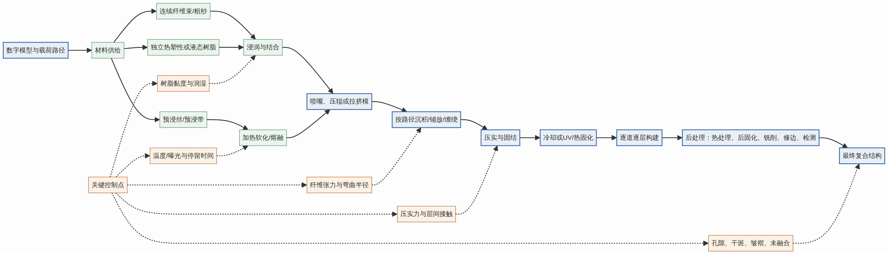
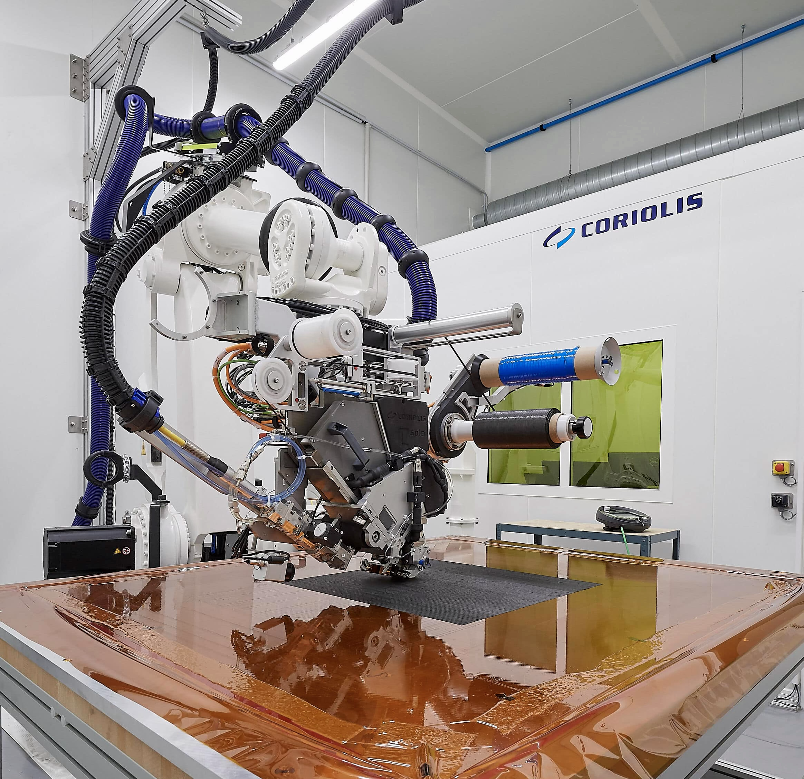
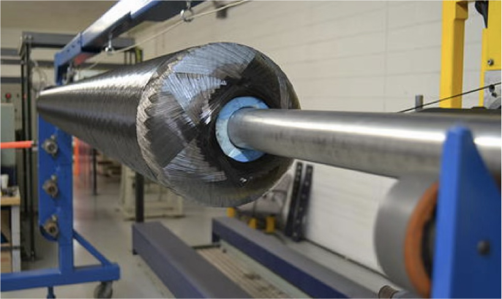
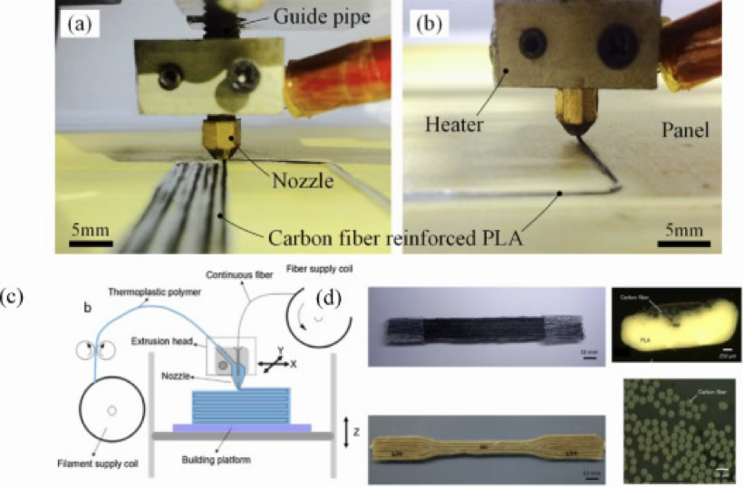
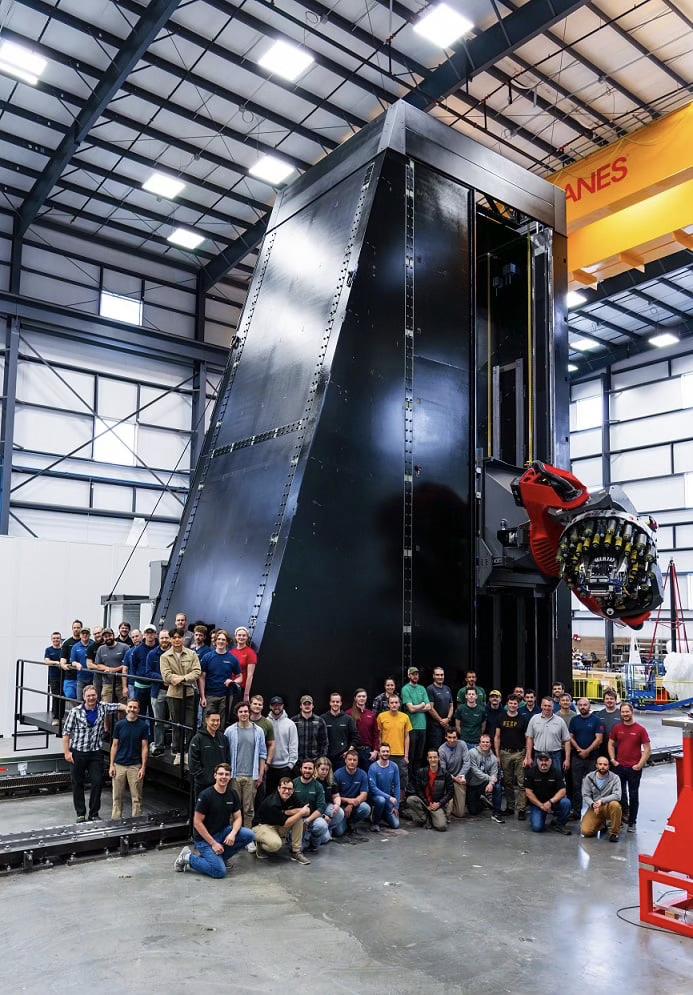

# 什么是连续纤维复合材料

## 1. 定义

连续纤维复合材料是指以连续不断的纤维作为增强体，与树脂、塑料、金属或陶瓷等基体材料结合形成的复合材料。其中，“连续”强调纤维在构件中具有较长的连续承载路径，而不是已被切成短段并随机分散在基体中的纤维。

从结构功能上看，连续纤维主要承担拉伸、压缩和弯曲载荷；基体则负责固定纤维位置、保护纤维免受环境影响，并通过界面将外部载荷传递至纤维。通过调整纤维方向、铺层顺序和纤维含量，可使材料性能适应特定的受力需求。

## 2. 基本组成

### 2.1 连续纤维增强体

常见的连续纤维增强体包括：

- 碳纤维：强度高、刚度高、密度低，常用于航空航天、汽车轻量化和机器人结构。
- 玻璃纤维：成本较低、绝缘性好、耐腐蚀，常用于风电、船舶、建筑和工业设备。
- 芳纶纤维：韧性和抗冲击性能较好，常用于防护结构和抗冲击部件。
- 玄武岩纤维和天然纤维：可用于耐腐蚀、低成本或可持续材料方向。

### 2.2 基体材料

基体包覆并固定纤维，使纤维保持设计方向，并把外部载荷传递到纤维上。常见基体包括环氧树脂、不饱和聚酯树脂、乙烯基酯树脂，以及尼龙、聚丙烯、PEEK、PEKK、PEI等热塑性塑料。光固化树脂也可作为连续纤维打印中的液态基体。

## 3. 与短纤维复合材料的区别

| 对比项目 | 连续纤维复合材料 | 短纤维复合材料 | 典型制造方式 | 主要特点 |
| --- | --- | --- | --- | --- |
| 纤维形态 | 纤维连续，可贯穿较长结构路径 | 纤维被切成短段 | 连续铺放、缠绕、拉挤、连续纤维打印 | 可形成连续载荷路径 |
| 纤维方向 | 可以按受力方向定向排列 | 通常较分散或随机 | 预浸料铺层、AFP/ATL、机器人沉积 | 方向性明显 |
| 主要性能 | 纤维方向强度和刚度很高 | 性能更均匀，但增强效果相对较低 | 注塑、挤出、短纤FDM | 适合一般结构和外壳 |
| 典型应用 | 飞机结构、压力容器、风电叶片、机器人部件 | 汽车内饰、外壳、普通结构件 | 按产品形状和批量选择 | 连续纤维更适合轻量承力结构 |

注意：材料名称中含有“碳纤维”，并不意味着其一定是连续纤维复合材料。例如，若碳纤维增强尼龙打印丝材使用的是短切碳纤维，则应归为短纤维复合材料。

## 4. 受力与性能特点

连续纤维复合材料具有明显的各向异性。以单向碳纤维复合材料为例，沿纤维方向的强度和刚度通常较高；垂直纤维方向的性能主要由树脂和纤维—树脂界面决定；层间方向则容易受孔隙、分层和界面结合质量的影响。

- 0°方向：主要承受纵向拉伸和压缩载荷。
- 90°方向：改善横向承载能力和尺寸稳定性。
- ±45°方向：主要用于承受剪切和扭转载荷。

工程上通常采用多方向铺层，而非只使用单一方向的纤维。通过0°、90°、±45°等不同角度的组合，可获得满足强度、刚度、稳定性和损伤容限要求的层合结构。

## 5. 常见制造工艺

### 5.1 预浸料铺层

将预先浸渍树脂的连续纤维带按照设计角度和层序铺放，再通过热压罐、模压、烘箱或其他方式固化成形。该方法适合高性能层合板和复杂结构。

### 5.2 自动纤维铺放与自动带铺放（AFP/ATL）

使用机器人或自动铺放头，将连续预浸窄带或宽带按数字路径放置在模具、芯模或已有基材上。AFP更适合多条窄带、复杂曲面和局部变厚；ATL通常采用较宽带材，适合大型、较平坦或低曲率表面。

### 5.3 纤维缠绕

将连续纤维按环向、螺旋或纵向路径缠绕在芯模上，常用于压力容器、管道和回转体结构。纤维缠绕角度可以根据环向强度、轴向强度和内压载荷进行设计。

### 5.4 拉挤成形

连续纤维经树脂浸润后，通过成形模具和牵引系统生产杆、梁、管等恒截面型材。传统拉挤的优势在于连续生产效率高、纤维方向稳定，但产品形状通常受恒截面和直线生产条件的限制。

### 5.5 连续纤维增材制造

将连续纤维与热塑性或热固性基体结合，并沿数字化路径逐道打印、铺放或沉积。常见路线包括连续纤维挤出或共挤、树脂在线浸润、机器人连续纤维沉积和光固化连续纤维打印。

## 6. 优点与局限

### 6.1 主要优点

- 比强度和比刚度高，适合轻量化承力结构。
- 可以沿主要受力方向进行定向增强。
- 耐腐蚀性能较好，适合恶劣环境。
- 可通过铺层角度和纤维路径设计，获得所需的各向异性性能。
- 适合航空航天、汽车、风电、机器人和高性能装备等领域。

### 6.2 主要局限

- 纤维方向性强，横向和层间性能相对较弱。
- 容易出现分层、孔隙、纤维波曲和界面脱粘。
- 对制造工艺和质量检测的要求较高。
- 纤维转弯半径、铺层角度和成形路径受到限制。
- 热固性复合材料通常较难回收。
- 材料、设备和工艺成本一般高于普通塑料或短纤维复合材料。

## 7. 典型应用

- 航空航天：机翼、机身、支架、整流罩和轻量承力结构。
- 汽车与轨道交通：车身结构、电池箱体、传动部件和轻量化支架。
- 风电与能源：风电叶片、压力容器、管道和储能设备结构。
- 机器人与工业装备：机械臂、末端执行器、夹具、工装和检具。
- 船舶与建筑：船体加强件、桥梁加固件、复合材料梁柱和网格结构。
- 医疗与运动器材：假肢、矫形器、护具、自行车部件和运动器材。

## 8. 总结

连续纤维复合材料，就是用连续不断的高强度纤维作为主要承载骨架，再用树脂或其他基体将纤维固定、保护并连接起来，从而获得高强度、低重量和可定向设计性能的复合材料。

理解这类材料时，应同时关注三个方面：纤维是否连续、纤维方向是否与载荷匹配，以及纤维与基体之间的浸润和界面结合是否良好。连续纤维本身不是性能保证，材料形态、制造工艺、孔隙率、层间质量和服役环境同样决定最终性能。

图片说明：本文图片均为公开网页或论文页面中的真实设备、工艺照片或论文配图，未使用 AI 生成图片。图片用于技术说明，具体版权和再发布权限以原始来源页面为准。
